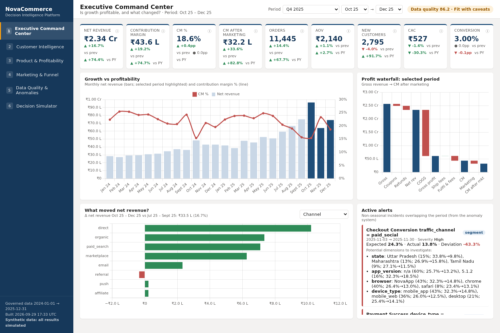
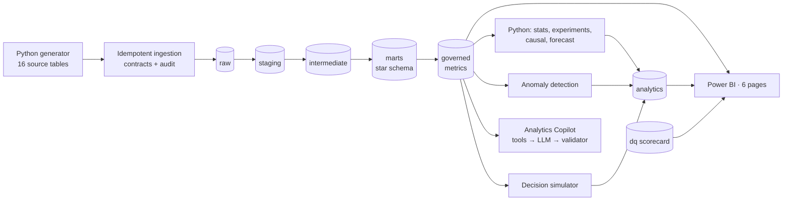
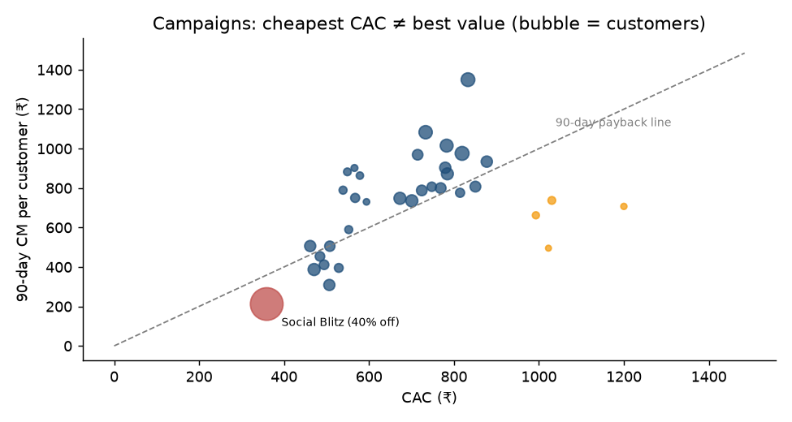
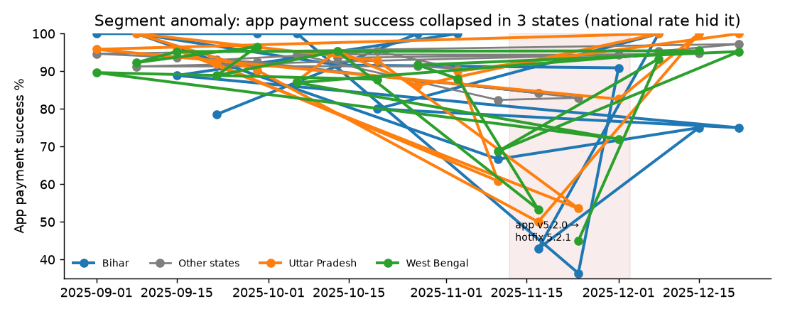
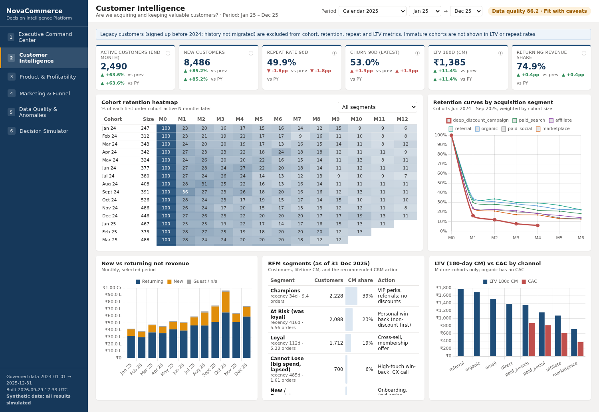
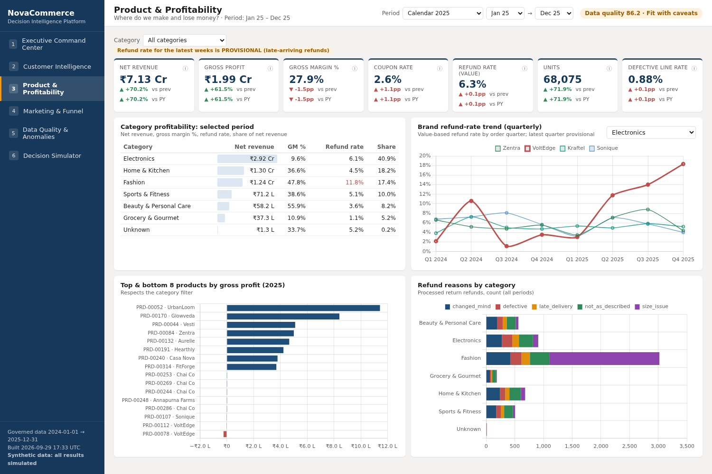
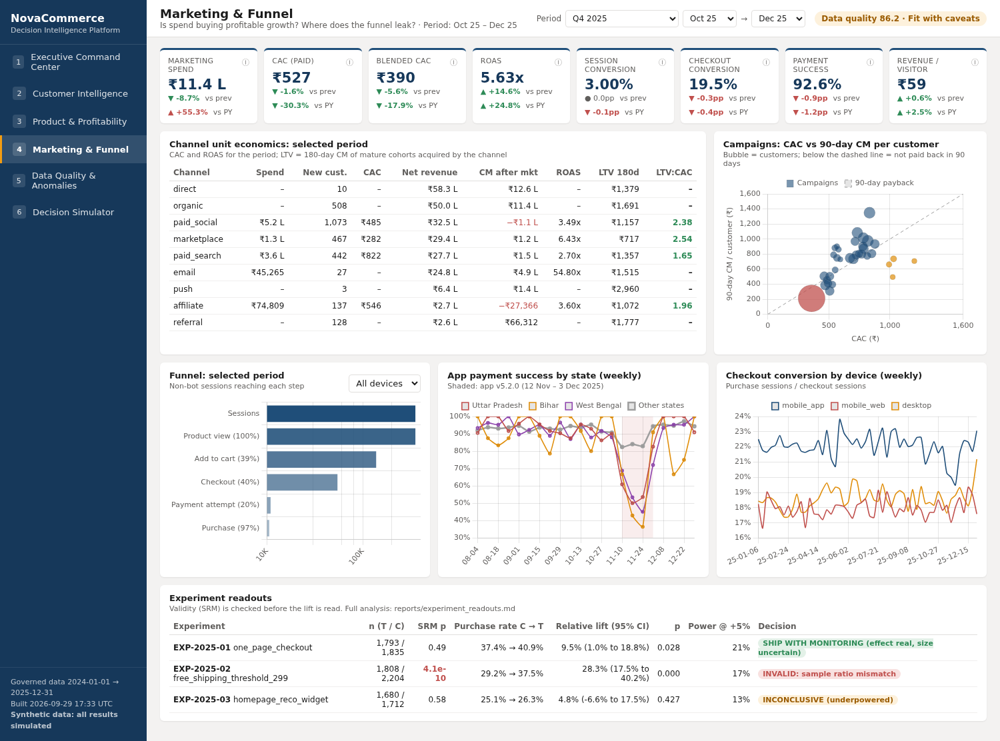
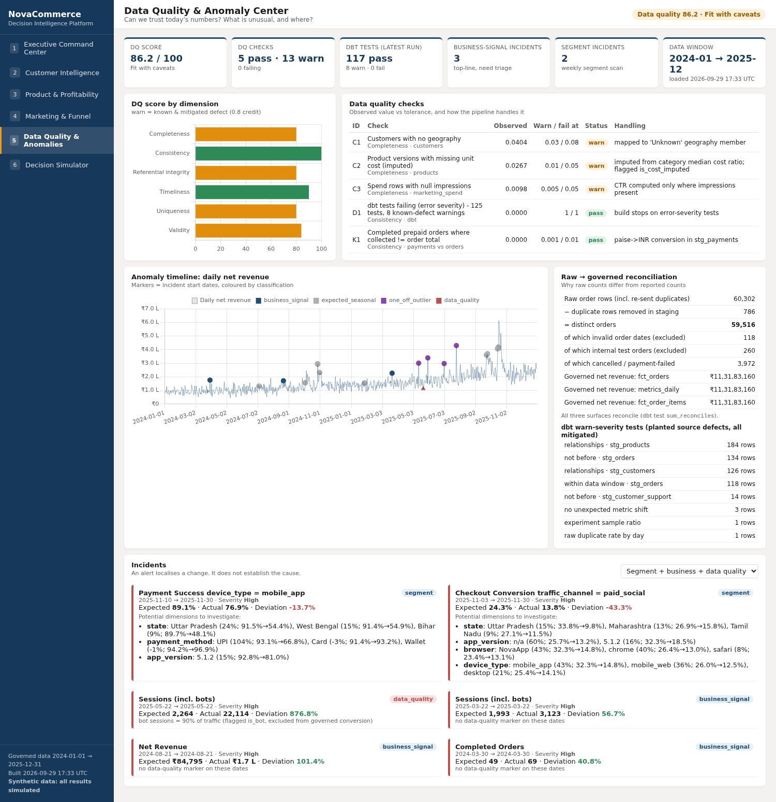
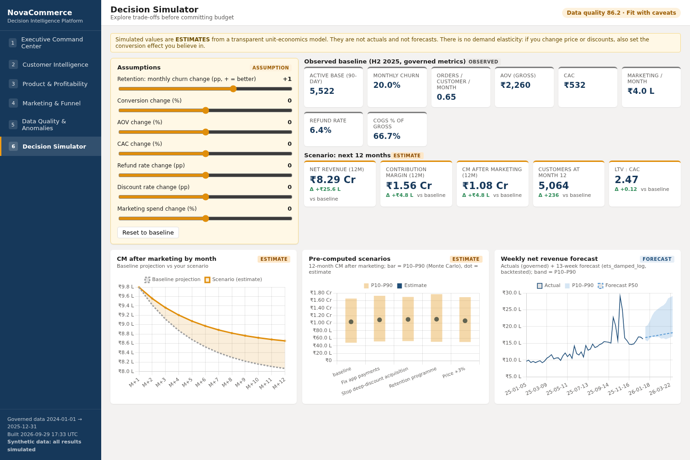

# NovaCommerce: Decision Intelligence & Revenue Analytics Platform

> An end-to-end, production-style analytics platform for a fictional Indian D2C e-commerce + subscription business. It takes messy source data, turns it into governed metrics, and uses them to explain **why profitable growth is changing and what leadership should do about it**.
>
> *All data is synthetic, generated with planted business scenarios and realistic defects. All impact figures are simulated.*

> **New here? Read [`START_HERE.md`](START_HERE.md).** It covers setup, running each step from Step 1 to the end, what every folder does, and how to study the project for interviews.
>
> **Dashboard:** open [`powerbi/dashboard/NovaCommerce_Dashboard.html`](powerbi/dashboard/NovaCommerce_Dashboard.html) (6 interactive pages on governed data). To build the Power BI version, see [`powerbi/README.md`](powerbi/README.md).



---

## 1. Executive summary

NovaCommerce grew net revenue **+70% in 2025 (₹4.19 Cr → ₹7.13 Cr)**, but contribution margin % fell from **23.6% in H1 to 16.5% in Aug–Oct**. The platform traces the dilution to a 40%-off paid-social campaign. That campaign had the **cheapest CAC (₹359)** and the **worst 90-day contribution per customer (₹212)**, and only 32% of its customers bought again. The platform also found an app release that broke UPI payments in three states. The national payment dashboard missed it, and the segment-level anomaly monitor caught it. It flagged a supplier quality problem (VoltEdge refunds 3% → 18%), invalidated an A/B test with a sample-ratio mismatch before anyone shipped a fake +28% lift, and showed that "members order 4× more" is mostly self-selection.

**Recommendations:** cap first-order discounts and judge campaigns on 90-day CM payback, monitor payments at segment level with release canaries, run supplier corrective action, and run a randomised membership trial before scaling Nova Plus. The full memo is in [`docs/08_executive_memo.md`](docs/08_executive_memo.md).

## 2. Business problem

> *"Why is profitable growth changing, which customers, products and channels are driving the change, what risks are emerging, and what actions should leadership consider?"*

The problem is hard in practice, not in theory. Revenue is defined differently by different teams, source systems send duplicates, paise and UTC timestamps, refunds arrive weeks late, experiments get logged wrongly, and averages hide segment-level failures. The project treats **trustworthy numbers** as the first deliverable, and insight as the second.

## 3. Stakeholders

| Stakeholder | Decision | Where it's answered |
|---|---|---|
| CEO / CFO | Growth vs margin, discount policy | Exec Command Center, margin waterfall, memo |
| CMO | Channel and campaign budget | Channel economics, campaign CAC vs 90-day CM |
| Head of Product | Funnel and app priorities, experiments | Funnel page, anomaly centre, experiment readouts |
| Category / CX | Supplier quality | Product & Profitability page |
| Data lead | Is today's data fit for decisions? | DQ scorecard (86.2 / 100, "fit with caveats") |

Requirements with IDs: [`docs/01_business_requirements.md`](docs/01_business_requirements.md).

## 4. Architecture



| Layer | Tech | Why this tool |
|---|---|---|
| Source simulation | Python / NumPy | Planted, known effects let us **validate methods against ground truth** |
| Ingestion | Python + psycopg COPY | Contracts, SHA-256 idempotency, audit log, raw-as-TEXT (ADR-003) |
| Warehouse | PostgreSQL 16 (Docker) | Free, reproducible, real EXPLAIN/indexes/partitioning (ADR-001) |
| Transformation + tests | dbt-core + dbt_utils | Versioned SQL, lineage, 125 tests (ADR-002) |
| Analytics | pandas, SciPy, statsmodels | Inference, CUPED, STL, ETS, where SQL is the wrong tool |
| BI | Power BI | Market-standard BI in India. It sits on governed tables only |
| Orchestration / CI | Makefile, GitHub Actions | One daily batch. CI builds and tests on every push (ADR-005) |

Details: [`docs/02_architecture.md`](docs/02_architecture.md).

## 5. Data model

A star schema of **11 facts and 9 dimensions** at declared grains (order, order line, payment attempt, refund, session, session×step, date×campaign, ticket, subscription, experiment×customer, customer×month). **SCD Type 2** is used for customers (geography) and products (price/cost), with point-in-time joins. Conformed channel dimension. Unknown members instead of NULL foreign keys.
Model & grain rationale: [`docs/03_data_model.md`](docs/03_data_model.md). Data dictionary: [`docs/04_data_dictionary.md`](docs/04_data_dictionary.md) (generated from the warehouse).

## 6. Metrics (governed)

There are 21 certified metrics in a catalogue that every surface reads. Each one has a business definition, formula, SQL, grain, filters, exclusions, edge cases and **common ways analysts get it wrong**. See [`docs/05_metric_definitions.md`](docs/05_metric_definitions.md). Key rules:

- Measures in `fct_orders` are pre-filtered, so `SUM(net_revenue)` is always the governed number.
- Ratios are stored as numerator + denominator.
- Refunds are attributed on an order-date basis and flagged as provisional while late refunds arrive.
- Cohort metrics count only mature customers.
- Legacy (pre-migration) customers are excluded from cohorts.

dbt tests reconcile net revenue across `metrics_daily`, `fct_orders` and `fct_order_items`.

## 7. Methodology

| Question | Method | Output |
|---|---|---|
| What changed and why? | MoM/YoY, volume × value decomposition, contribution-to-change, margin waterfall | [`sql/analysis/01-03, 26`](sql/analysis) |
| Customer value | Cohort retention, 90-day repeat, 180-day CM LTV (maturity-aware), RFM validated out-of-sample | `mart_*`, [`reports/customer_segmentation.md`](reports/customer_segmentation.md) |
| Channel economics | CAC, ROAS, LTV:CAC, campaign 90-day CM payback | `mart_channel_monthly_economics`, `sql/analysis/09,16` |
| Is it unusual? | Same-weekday robust z (median/MAD, sale days masked), STL cross-check, quasi-binomial z for rates, **weekly segment scan**, contribution drill-down, DQ-vs-business classification | [`reports/anomaly_detection.md`](reports/anomaly_detection.md) |
| Did the experiment work? | SRM χ², balance SMD, two-proportion z + Newcombe CI, Welch + bootstrap, CUPED, power/MDE, Holm/BH | [`reports/experiment_readouts.md`](reports/experiment_readouts.md) |
| Does membership cause ordering? | Naive → regression → coarsened matching → matched diff-in-diff | [`reports/causal_membership.md`](reports/causal_membership.md) |
| What next? | Rolling-origin backtested forecast, Monte Carlo decision simulator (observed / assumption / forecast / estimate labels) | [`reports/revenue_forecast.md`](reports/revenue_forecast.md), [`reports/decision_simulator.md`](reports/decision_simulator.md) |
| Can I just ask? | Copilot limited to governed tools, with a numeric grounding validator and an eval suite (13/13 end-to-end, 5/5 adversarial) | [`reports/copilot_evaluation.md`](reports/copilot_evaluation.md) |

## 8. Key findings (simulated)

1. **Growth was bought, not earned, in Aug–Oct 2025.** CM % went from 23.6% to 16.5%, the coupon rate from 1.5% to 4.9% of gross, and CM after marketing from 19.3% to 9.6%. 90-day repeat for those cohorts is 42–44%, against 55–57% before.
2. **Cheapest CAC ≠ best customers.** The "Social Blitz" campaign had a CAC of ₹359, a 90-day CM of ₹212 per customer, and a 32% repeat rate. It is the only large campaign far below the payback line.
   
3. **Averages hide failures.** The national payment success rate stayed within normal range. App payment success fell from 89.1% to 76.9%, in Uttar Pradesh from 91.5% to 54.4%, almost entirely on UPI, from app v5.2.0 until the hotfix. About 64 extra failed app-UPI orders in 3 weeks.
   
4. **Emerging quality risk.** VoltEdge refunds went from about 3% to 18% (Q4 2025, still provisional). Its defective-line rate went from 9% to 16%.
5. **Experiments.** One-page checkout: +9.5% (CI +1.0% to +18.8%), so ship with a holdout. Free-shipping ₹299: an apparent +28% lift, **invalid because of SRM**. Reco widget: underpowered.
6. **Membership.** The naive effect is +439%. A matched diff-in-diff gives +51%, which is still an upper bound, so a randomised trial is needed.
7. **Data trust.** The DQ score is 86.2. The duplicate batch on 18 Mar 2025 doubled that day's raw revenue and is absent from governed metrics.

## 9. Business recommendations

| Action | Est. 12-month Δ CM after marketing (**estimate**) |
|---|---|
| Retention programme for At-Risk / New segments | +₹6.8 L |
| Cap first-order discounts at 10–15%; judge campaigns on 90-day CM payback | +₹6.3 L |
| Segment-level payment monitoring + state/PSP release canaries | +₹5.2 L |
| VoltEdge supplier corrective action | not modelled |
| Randomised Nova Plus trial before scaling acquisition spend on it | decision value |

## 10. Limitations

- **Synthetic data.** The effects were planted deliberately, and the value of the project lies in the methods and engineering, not in the specific numbers.
- **Attribution.** Last non-direct touch, which over-credits bottom-funnel channels.
- **Tax.** GST-inclusive prices, no tax accounting.
- **Visitors.** No cross-device visitor ID, so RPV is revenue per session.
- **Simulator.** No demand elasticity. Every scenario states its conversion assumption.
- **Causal estimate.** The membership estimate is an upper bound, because of unobserved selection.
- **Legacy rule.** Pre-2024 sign-ups are excluded from cohorts, which also drops some true 2024 first-timers.
- **Experiments.** They are small relative to the active base, which is why the power analysis says so.

## 11. Tech stack

Python 3.11 · pandas · NumPy · SciPy · statsmodels · PostgreSQL 16 · dbt-core 1.10+ · dbt_utils · Power BI · Docker · GitHub Actions · ruff · pytest · optional: Anthropic/Ollama LLM and Streamlit for the Copilot UI.

## 12. How to reproduce

```bash
git clone <repo> && cd nova-commerce-analytics
cp .env.example .env
python -m venv .venv && source .venv/bin/activate
make setup          # pip install -e ".[dev,copilot]"
make db-up          # Postgres 16 in Docker
make all            # generate → ingest → dbt build → dq → analytics → anomalies → simulate → copilot-eval
make test           # unit tests
make dbt-docs       # lineage + docs site
make copilot-app    # optional Streamlit UI (COPILOT_PROVIDER=offline|anthropic|ollama)
```

A full run with the default 30k customers (about 60k orders, 1.7M sessions, 2.8M events) takes about 2–3 minutes on a laptop. `make sample` plus `make ci` runs the small CI dataset. Then build the Power BI report with [`powerbi/README.md`](powerbi/README.md).

## 13. Dashboard & screenshots

The 6-page dashboard (`make dashboard` → `powerbi/dashboard/NovaCommerce_Dashboard.html`) follows the Power BI spec. It reads only governed tables, and every simulated number is labelled as an estimate.

| | |
|---|---|
|  |  |
|  |  |
|  |  |

To build the Power BI `.pbix`, use [`powerbi/README.md`](powerbi/README.md) with the CSV data pack in `powerbi/data/` (or a live Postgres connection), [`report_spec.md`](powerbi/report_spec.md) and [`dax_measures.md`](powerbi/dax_measures.md). Analysis charts are in `docs/images/`.

## 14. Future improvements

- dbt MetricFlow semantic layer, with Power BI connected through it
- Incremental models with lookback and dbt snapshots for current-state sources
- Airflow/Dagster once there are more than 20 jobs
- Multi-touch / data-driven attribution, validated with geo-holdout tests
- Randomised membership encouragement trial (IV/CACE)
- Sequential testing (always-valid p-values) for experiments
- PSI-based input drift monitoring
- Copilot feedback loop and logging

## Repository map

```
docs/            strategy, requirements, architecture, data model, dictionary, metrics, DQ, memo, scaling, ADRs,
                 interview prep (131 Q&A), career assets
data/            ground_truth/ (planted scenarios: for evaluation only), sample/ (CI)
ingestion/       load_raw.py + schemas/contracts.yml
dbt/nova_dbt/    staging → intermediate → marts → metrics, seeds, macros (casting + custom tests), singular tests
sql/analysis/    27 interview-grade queries (business question, why it works, performance, scale)
sql/performance/ EXPLAIN case studies, partitioning, scaling notes
python/nova/     generator, analytics, anomaly, dq, simulator, copilot, common
reports/         generated results (committed so reviewers can read them without running anything)
powerbi/         6-page HTML dashboard, Power BI CSV data pack, build guide, spec, DAX library, theme, screenshots
tests/           pytest (generator determinism, validator, planner, detectors, simulator)
```
