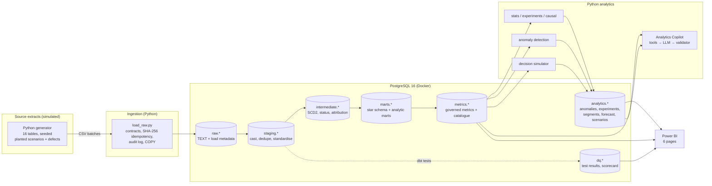

# Architecture

## Layer responsibilities

| Layer | Tool | Responsibility | Materialisation | Never does |
|---|---|---|---|---|
| raw | Python | Land data exactly as received, plus `_batch_id`, `_source_file` and `_loaded_at` | append-only tables (TEXT) | transform or reject individual rows |
| staging | dbt | Cast defensively, rename, dedupe, standardise labels via seeds, convert UTC to IST | views (big sources: indexed tables) | join business entities |
| intermediate | dbt | Business logic: order status, reportability, attribution, SCD2, coupon allocation, sessionised funnel | tables | expose to BI |
| marts | dbt | Star schema (facts at a declared grain + conformed dims) and wide analytic marts | tables + indexes | recompute raw logic |
| metrics | dbt | Governed metric components + certified catalogue | tables / view | define anything not in the catalogue |
| analytics | Python | Statistical outputs written back for BI | tables | redefine metrics |

## SQL vs Python: the division of labour

| Use SQL (dbt) when… | Use Python when… |
|---|---|
| the work is set-based: joins, aggregations, window functions | it is statistics or inference (tests, CIs, bootstrap, CUPED, regression) |
| the result is a reusable model other people query | it is iterative or simulation-based (Monte Carlo, backtests) |
| it defines a metric (it must be testable and versioned in the warehouse) | it uses time-series models (STL, ETS) or custom anomaly logic |
| the data is large (compute next to the data) | it talks to external systems (files, LLM APIs) |

Example: the funnel counts are SQL (`mart_funnel_daily`). Whether a drop in them is *statistically unusual* is Python (`nova.anomaly`).

## Orchestration

A `Makefile` runs one daily batch: `generate → ingest → dbt build → dq → analytics → anomalies → simulate → copilot-eval`. Airflow or Dagster would add a scheduler, retries and a UI, which is valuable at 20+ jobs. At 8 steps it is overhead. The production path is described in `09_scaling_and_production.md`.

## CI

GitHub Actions runs `ruff` → a 1,500-customer sample generation → ingestion → `dbt build` (all tests) → `pytest`, on every push. A PR cannot merge if a model or a governed-metric reconciliation breaks.
