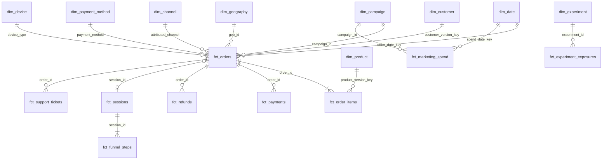

# Data Model

## Star schema

## Fact tables and their grain

| Fact | Grain (one row per…) | Type | Why it exists |
|---|---|---|---|
| `fct_orders` | order | accumulating snapshot (placed → paid → shipped → delivered/cancelled) | Revenue, margin, fulfilment timing. The heart of executive metrics |
| `fct_order_items` | order line | transaction | Product, brand and category profitability. Coupon allocation |
| `fct_payments` | payment attempt | transaction | Payment success by method, device and version (S2) |
| `fct_refunds` | refund transaction | transaction | Refund reasons and lags. Order-date vs refund-date views |
| `fct_sessions` | session | transaction | Traffic and conversion. Bots flagged |
| `fct_funnel_steps` | session × funnel step reached | derived transaction (long) | Funnel visual with the step as a dimension |
| `fct_marketing_spend` | date × campaign | periodic snapshot | CAC, ROAS, CM after marketing |
| `fct_support_tickets` | ticket | transaction | CX drivers linked to orders |
| `fct_subscriptions` | subscription | transaction | Nova Plus economics |
| `fct_experiment_exposures` | experiment × customer | factless fact + outcomes | Experiment analysis without leakage |
| `fct_customer_monthly` | customer × month (from first order) | periodic snapshot (dense) | Retention and churn need the months with **no** orders |

**Why these grains?** A fact must be at the *lowest grain at which the business event happens and is measured*.

- Payments are per attempt, not per order, because a retried payment is two events. Collapsing them hides the failure rate.
- Items are separate from orders because coupons and refunds live at different levels. Joining orders to items to payments in one table *fans out* revenue. The dbt test `assert_no_fanout_order_items` guards against this.
- Aggregate facts (`metrics_daily`) are **derived**, never the system of record.

## Dimensions

| Dimension | Key | SCD | Notes |
|---|---|---|---|
| `dim_customer` | `customer_version_key` = md5(customer_id, updated_at) | **Type 2** on geography | Built from CDC rows. First version is valid from 1900-01-01 so no order falls "before" the customer. `'unknown'` member for guests and orphans. Email hashed. `is_legacy_customer` |
| `dim_product` | `product_version_key` | **Type 2** on price and cost | Historical margin uses the historical cost. Missing cost imputed and flagged |
| `dim_date` | `date_key` (YYYYMMDD) | static | Generated spine (no gaps), Indian fiscal year, festival and sale flags |
| `dim_geography` | `geo_id` | Type 1 | `'-1'` Unknown member |
| `dim_channel` | `channel` | Type 1 | **Conformed** across orders, sessions and spend via one seed mapping |
| `dim_campaign` | `campaign_id` | Type 1 | Discount depth, objective |
| `dim_payment_method`, `dim_device`, `dim_experiment` | natural keys | static | Small reference dims |

### SCD decisions

- **Type 2 where history changes the answer.** If a customer moves from Lucknow to Pune, orders placed while they lived in Lucknow must stay in Uttar Pradesh. Type 1 would silently move historical revenue to Maharashtra.
- **Type 1 where it doesn't.** A campaign name correction should rewrite history.
- The SCD2 in this project is **built from CDC rows** in `int_customers__scd2` (window functions: `lead(updated_at)`), not from dbt snapshots. The source already sends one row per version. Snapshots are the right tool when the source only sends the current state (see `09_scaling_and_production.md`).
- Point-in-time join: `o.order_at >= valid_from and o.order_at < valid_to` (inclusive start, exclusive end), tested by `assert_scd2_no_overlap`.

## Analytic marts (wide, BI-friendly)

`mart_customer_ltv` (customer), `mart_cohort_retention` (cohort × segment × month offset), `mart_channel_monthly_economics` (month × channel), `mart_product_monthly` (month × product), `mart_funnel_daily` (date × device × state × channel × version).

## Metric layer

`metrics_daily` (date), `metrics_daily_by_dimension` (date × dimension × value, **long format, components only**), `metrics_monthly` (month, with MoM/YoY and cohort metrics), and `metric_catalog`. The full column list is in `04_data_dictionary.md`.
